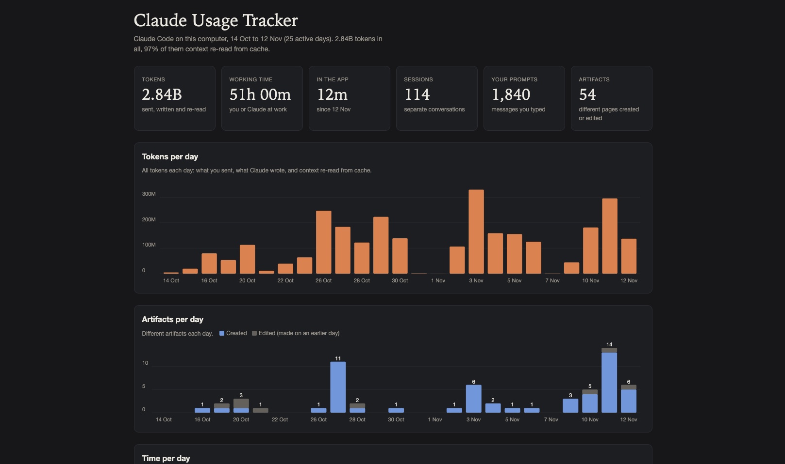

# Claude Usage Tracker

A small, private dashboard of how you use Claude Code: tokens, time, artifacts, tools and models, plus a widget for your Mac desktop.

Everything is read from the logs Claude Code already keeps on your computer. Nothing is uploaded anywhere.




## What you get

- **A dashboard page** (`~/.claude/usage-tracker/dashboard.html`), refreshed every hour:
  - tokens per day, by model, by folder, and by weekday and hour
  - artifacts created and edited each day
  - working time per day, and your typical day hour by hour
  - your most used tools and heaviest sessions
  - a few fun facts, such as how many novels' worth of text Claude has written for you
- **A desktop widget** (with [Übersicht](https://tracesof.net/uebersicht/)) showing today's time in the app, working time, tokens and artifacts, plus a 7-day chart. Click it to open the dashboard.
- **Time in the app** (optional): a tiny background job checks once a minute whether the Claude app is in front and you're at the computer. It records only the minute, nothing about what's on screen.

## Install (macOS)

```bash
brew install --cask ubersicht          # optional, for the desktop widget
git clone https://github.com/JurenaMat/claude-usage-tracker.git
cd claude-usage-tracker && ./install.sh
```

Skip the time-in-the-app tracker with `./install.sh --no-focus`. Run `./install.sh` again to update.

To remove everything:

```bash
./uninstall.sh
```

**Linux or Windows:** the widget and trackers are macOS-only, but the dashboard works anywhere with Python 3.8+:

```bash
python3 src/build.py usage.json --html dashboard.html
```

## How the numbers are counted

- **Tokens** come from the usage that Claude Code records with every reply in `~/.claude/projects/**/*.jsonl`. Each reply is counted once, including replies from helper agents. Most tokens are *cache reads*: context Claude has already seen and re-reads cheaply on each turn.
- **Working time** adds up the gaps of 5 minutes or less between messages and tool steps. Change the cut-off with `--idle SECONDS`.
- **In the app** counts minutes where the Claude app was in front and the keyboard or mouse was used in the last 5 minutes. It starts when you install it and has no earlier history.
- **Artifacts** counts different artifacts per day. One you create and change on the same day counts once, as created.
- **Not included:** chats on claude.ai or the phone apps, which aren't stored on your computer. Claude Code also deletes logs older than about 30 days (see `cleanupPeriodDays` in its settings), so history stops there unless you raise that.

## Privacy

The dashboard shows your session titles and folder names. Before you share a screenshot, rebuild without titles:

```bash
python3 ~/.claude/usage-tracker/build.py --html ~/Desktop/usage.html --no-titles
```

## Files

| Path | What it is |
|---|---|
| `src/build.py` | Reads the logs and writes `claude-usage.json` (and the dashboard with `--html`) |
| `src/dashboard.html` | Dashboard template; the data is inlined so the page works offline |
| `src/focus-tick.sh` | Once-a-minute check for the time-in-the-app tracker |
| `widget/index.jsx` | The Übersicht desktop widget |

MIT licensed. Not affiliated with Anthropic.
